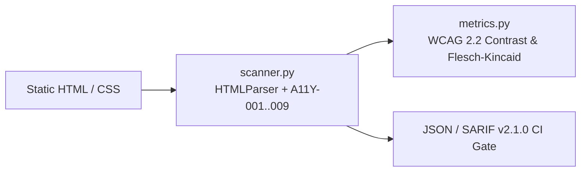

# a11y-gate

[](https://github.com/codesphere-u/a11y-gate/actions/workflows/ci.yml)
[](LICENSE)
[](pyproject.toml)
[](pyproject.toml)

**Deterministic static HTML/CSS WCAG 2.2 accessibility, W3C relative-luminance contrast ratio, keyboard-navigation, and Flesch-Kincaid plain-language readability CI gate with SARIF v2.1.0 output.**

- **Mission Domain:** Accessibility & Assistive Technology
- **Stack:** Pure Python 3.11+ (zero runtime third-party dependencies, `mypy --strict`, `ruff`, `pytest`)
- **Maintainer:** Codesphere Innovations (U) Limited (`codesphere-u`)

---

## Problem Solved

Web portals routinely pass basic syntax checks while locking out blind, low-vision, keyboard-only, and low-literacy users through missing `<label>` bindings, `outline: none` focus suppression, low color contrast, and dense bureaucratic prose.

## Key Features

- Exact W3C WCAG 2.2 sRGB linearization, relative luminance, and contrast ratio (`1.0:1`..`21.0:1`) supporting `#RGB`, `#RRGGBB`, `rgb()`, and named CSS colors.
- 9 static WCAG 2.2 rules (`A11Y-001`..`A11Y-009`): page `lang`, `img alt`, form labels, heading order, positive `tabindex`, clickable `div`/`span`, inline contrast `< 4.5:1`, focus `outline: none`, and Flesch-Kincaid reading grade.
- Direct SARIF v2.1.0 export for GitHub Code Scanning CI gates.

## Architecture Overview



See [docs/architecture.md](docs/architecture.md) for module-level design details.

## Installation

```bash
git clone https://github.com/codesphere-u/a11y-gate.git
cd a11y-gate
uv sync --extra dev
```

Or install in editable mode with standard `pip`:

```bash
pip install -e ".[dev]"
```

## Quick Start (CLI)

```bash
a11y-gate contrast "#595959" "#ffffff"
a11y-gate scan ./dist --format sarif > a11y.sarif
```

## Quick Start (Python API)

```python
from a11y_gate import contrast_ratio, scan_html

assert contrast_ratio("#000000", "#ffffff") == 21.0
assert scan_html('<html lang="en"><body><h1>Accessible</h1></body></html>').passed
```

## Testing & Quality Gates

```bash
uv run ruff check src tests
uv run mypy src
uv run pytest -v
```

## Security, Contributing & Roadmap

- **Security:** See [SECURITY.md](SECURITY.md) for responsible disclosure procedures.
- **Contributing:** See [CONTRIBUTING.md](CONTRIBUTING.md) and [CODE_OF_CONDUCT.md](CODE_OF_CONDUCT.md).
- **Changelog & Roadmap:** See [CHANGELOG.md](CHANGELOG.md) and [ROADMAP.md](ROADMAP.md).

## License

MIT License — see [LICENSE](LICENSE).

## Support & Contact

Open an issue on [GitHub Issues](https://github.com/codesphere-u/a11y-gate/issues) or contact `codesphereinnovationz@gmail.com`.
